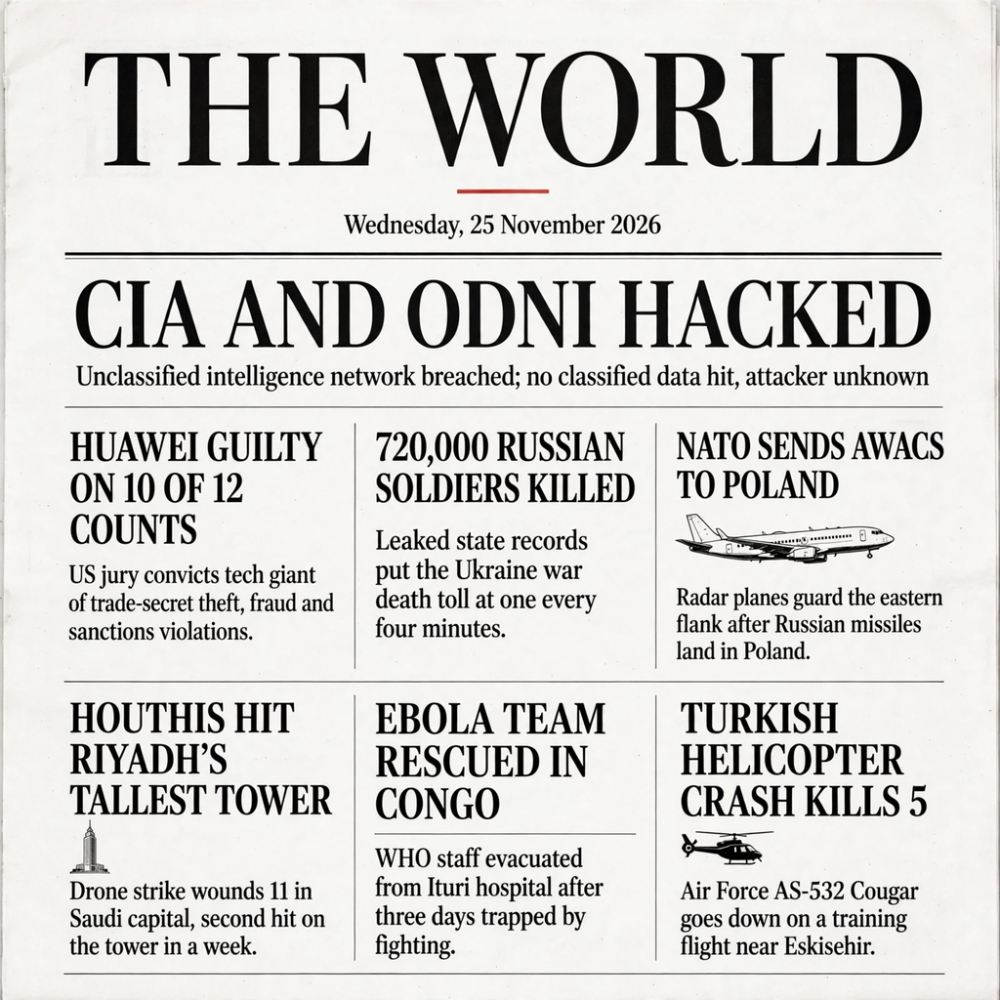

# THE WORLD — Wednesday, 25 November 2026

[](https://make.fun/bounty/news-image-20261125)
[](https://make.fun/bounty/news-image-20261125)
[](https://make.fun/bounty/news-image-20261125)

One image summing up the world's news of Wednesday, 25 November 2026 — an
entry for the [make.fun bounty](https://make.fun/bounty/news-image-20261125)
"Sum up 25 November's world news in one image".



## The seven stories

1. **CYBER — CIA and ODNI hacked.** An unclassified intelligence network is
   breached; officials say no classified data was hit and the attacker is
   still unknown.
2. **TECH — Huawei guilty on 10 of 12 counts.** A US jury in Brooklyn convicts
   the Chinese tech giant of trade-secret theft, fraud and sanctions
   violations; racketeering is the one big acquittal.
3. **WAR — 720,000 Russian soldiers killed.** Leaked Russian state records,
   analysed by Meduza and Mediazona, put the Ukraine war death toll at about
   one every four minutes — 490,000 deaths confirmed in the records, over
   720,000 once the missing are counted.
4. **NATO — AWACS sent to Poland.** The alliance forward-deploys radar planes
   to its eastern flank after three Russian cruise missiles land in Poland.
5. **GULF — Houthis hit Riyadh's tallest tower.** A drone strike wounds 11 in
   the Saudi capital, the second hit on the PIF Tower in under a week.
6. **HEALTH — Ebola team rescued in Congo.** WHO staff are evacuated from a
   hospital in Akwe, Ituri, after three days trapped by fighting.
7. **ACCIDENT — Turkish helicopter crash kills 5.** An Air Force AS-532
   Cougar goes down on a training flight near Eskisehir.

## How it runs

`main.ts` (Node 22, standard library only) copies `entry.png` unchanged to
the output directory. Run it locally with:

```sh
mkdir -p out && MAKEFUN_OUTPUT_DIR=out node main.ts
```

The image is 1024×1024 PNG, deterministic across runs.
